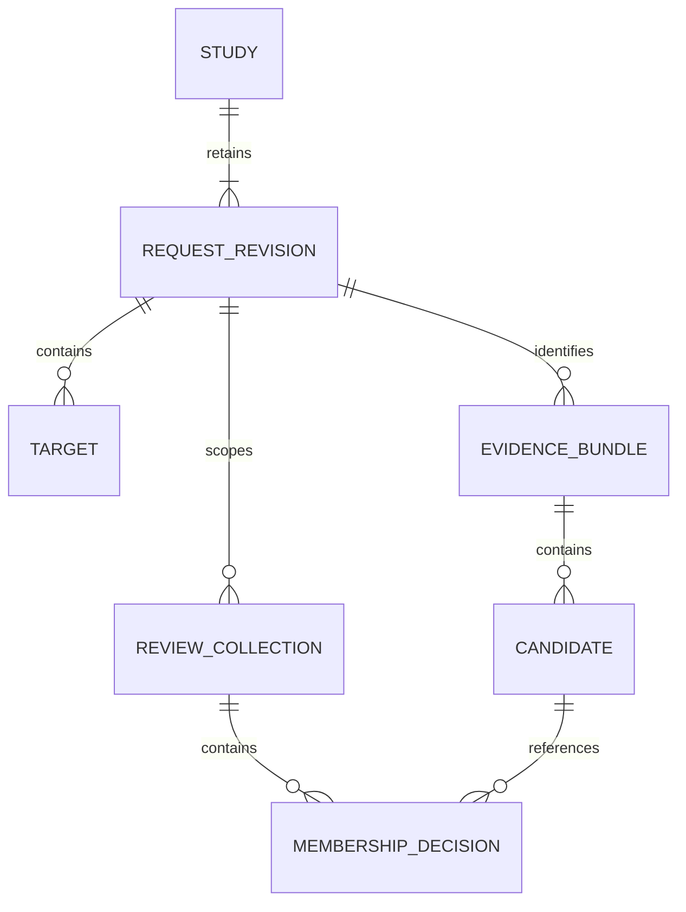

# Domain model and state transitions

Status: S5 normative local contract, version `1.0`; implementation pending.
The [exchange schema](../../contracts/exchange.schema.json) fixes wire fields.
The rules below additionally constrain references, equality and state transitions.

## Model

| Entity | Identity and fields | Rules |
| --- | --- | --- |
| Study | UUID `study_id`, UUID `request_id`, title, active revision, revisions, target labels, evidence files, collections, draft buffers | One request lineage; rename affects no analysis context |
| RequestRevision | UUID `revision_id`, reference/profile IDs, coordinate system, targets | Immutable analysis context; retained while study exists |
| Target | UUID `target_id`, contig accession, start, end, strand | Target ID survives edits; values are scoped to revision |
| EvidenceBundle | UUID `bundle_id`, request ID, exact revision context, category, source, candidates, dependencies | Immutable parsed object plus original UTF-8 bytes and SHA-256 |
| Candidate | Bundle-local string `candidate_id`, target ID, label, metrics, raw record | Global key `(bundle_id, candidate_id)`; no cross-bundle merging |
| ReviewCollection | UUID `collection_id`, name, revision ID, memberships | All members refer to evidence for this exact revision |
| MembershipDecision | Candidate key, disposition, rationale, evidence references | One per candidate key per collection; same candidate may occur in several collections |
| WorkspaceSession | UUID `workspace_id`, increasing `version`, `base_saved_version`, working Study, previous snapshot | Process memory; not an exported scientific identity |

No candidate identity is derived from its display label. Distinct bundles retain
distinct candidates even when sequences or names happen to match. A future
cross-source matching feature needs an independently reviewed identity contract.
Metric source is the bundle's source; each metric also names its model, scale,
unit and direction when supplied. Missing metadata stays null, not guessed.

## Accepted state versus input strings

`Study` contains structurally valid accepted intervals, but may have zero targets.
A zero-target study is saveable and not request-export-ready. An editor draft is
separate: `{target_id: UUID|null, label: string, contig: string, start: string,
end: string, strand: string}`. Null target means a not-yet-added target. Strings
preserve unfinished values such as an empty end field. There is at most one active
target draft and one decision draft per workspace; other accepted edits are intact.
A decision draft contains collection ID, candidate key, disposition and rationale.

Keystrokes update the client reducer. Apply submits a draft to a domain operation.
Invalid Apply returns diagnostics without changing accepted state. Successful Apply
clears only the captured draft generation; subsequent keystrokes survive. Save
submits current draft buffers even if invalid and stores them separately. Reopen
restores these as visibly **unapplied drafts**, never as accepted values. Export
never includes editor buffers. Discard draft affects no accepted revision.

Draft length limits: title/labels 200 characters, coordinate/contig strings 200,
rationale 4,000. Oversize buffers cannot be saved; keep them visible with a field
error. IDs in drafts must refer to existing entities or the explicit new-target
case. Removing the associated target/member clears its draft after confirmation;
Undo restores that draft with the removed object.

## Revision rules

1. Create study with a fresh study/request/revision UUID, default synthetic
   reference/profile and no targets. Save is explicit; initial saved version is 0.
2. Apply a new target, interval/strand/contig change, target removal, or context
   change: validate the complete proposed target set, then append one revision
   UUID and make it active. No partial change if any target becomes invalid.
3. An Apply with unchanged analysis data makes no revision. If labels or draft
   buffers change, the workspace version still advances. A completely unchanged
   operation is a no-op. Target order
   has no semantic meaning: normalize by target UUID for context comparison.
4. Changing title or target label changes working state but not revision ID.
   Labels are a study-wide map by target ID, retained for historical targets.
   Exports capture labels at export time; they are not scientific identity.
5. Every prior revision remains immutable, with evidence and collections attached
   to it. Historical requests can be viewed/exported; editing always starts from
   the active revision. The GUI must identify which revision is being viewed.
6. Duplicate copies the active target values and labels into fresh study/request/
   revision/target IDs. It copies neither evidence, decisions nor draft buffers.
7. Undo restores the prior working snapshot including active revision and drafts;
   it does not manufacture a reverse scientific revision. A discarded unsaved
   revision ID is never reused. A revision already saved is never removed by Undo,
   because Save clears the one-step history.

Retain up to 200 revisions per study. At the limit reject analysis changes with
`LIMIT_EXCEEDED`; suggest explicit duplication rather than deleting history.

## Validation boundaries

`validate_request` returns checks with `passed`, `failed` or `not_performed` and
field diagnostics. Export-ready means all required local checks pass:

- Known catalogue reference and profile; profile/reference category compatible.
- 1–50 unique target IDs, exact supported contig accession; no alias guessing.
- Integer coordinates in `[0, 2^53-1]`, `0 <= start < end <= contig_length`;
  fixed `0-based-half-open` convention; strand `+`, `-` or `.`.
- Valid UUIDs, nonblank title/labels, bounded fields and no duplicate keys.

Decimal coordinate input strings are parsed explicitly at Apply (ASCII digits
only); negative/decimal/exponent strings fail. Whitespace is not silently trimmed
from identifiers. Titles/labels/rationales are preserved; blankness checks use
Unicode whitespace. A profile describes the declared pre-experiment intent; no
sequence extraction, PAM inspection, off-target search, efficacy, assembly-file
checksum or biological suitability is checked. Each is `not_performed`, never a
passing consequence of valid coordinates.

Changing from synthetic to human reference requires an explicit context command
and valid accession-qualified replacement targets in the same command; the UI
shows the affected targets first. There is no coordinate conversion/liftover.

## Review state

Disposition enum: `undecided`, `include_for_review`, `exclude`,
`needs_clarification`. New membership starts undecided with empty rationale and
references. A non-undecided decision with blank rationale may be saved as an
incomplete draft decision. `undecided` and `needs_clarification` are unresolved
regardless of rationale. Review completeness is derived per selected collection.
An empty selected collection is unresolved; empty review selection is disallowed.

`evidence_refs` is a list of existing candidate keys in bundles for the same
request revision; it may be empty. References provide pointers, not authority to
rewrite observations. Removing a membership leaves all evidence intact. Removing
a collection removes its memberships only, and is Undo-able. At least one default
collection is created on the first evidence attachment for a revision; it is an
ordinary removable/renameable collection, not a hidden undeletable special case.

## Versions, concurrency and failure

- Workspace `version` starts at 1. Each accepted changing command, successful Save
  or Undo increments it; validation, preview, no-op and errors do not.
- Saved version starts at 0 (not persisted) and advances only on a successful
  SQLite commit. It is different from request revision identity.
- Serialize changes under the workspace lock. Reject a stale expected version
  before evaluating a command. Each tab opens a separate session; saving uses
  the last observed durable version to prevent lost updates across tabs.
- Failed commands replace neither working state nor Undo. Failed Save retains
  accepted state and drafts in the client, and the prior database row unchanged.
- After a lost changing-response, GET the workspace before retrying; do not
  blindly replay. If the session is gone, reopen the saved study and disclose
  that unsaved data may be lost. Browser reload alone can reconnect using the
  workspace ID in session storage; raw drafts typed since last Save are not
  guaranteed to survive reload.
- Undo is available only for the most recent accepted command; one snapshot,
  no redo. Save and reopening clear it. Navigation, previews and failed operations
  do not replace it. Undo with newer unapplied client text first requires an
  explicit Discard/Stay choice so restoring an earlier buffer cannot erase typing
  without notice. Server restart loses sessions and previews, not saved studies.

No automatic conflict merge: retain the working copy, offer reopen saved version
with explicit discard, or duplicate the active request into a new study. Explain
that duplication excludes review evidence; do not imply a full-review fork.
