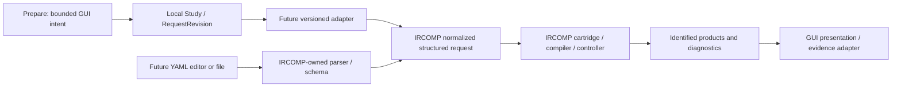

# IRCOMP integration boundary and gap register

Status: architectural alignment, 2 November 2026. No compiler integration is
implemented. This record owns the integration decision, missing meaning and
future acceptance gates. The [local API](api.md) defines the current ITU scope.

## Ownership and conversion

The intended frontend edits/views IRCOMP user specifications and displays identified
compiler products. The current Prepare module covers only interval-based CRISPR
intent; Review is a separate workspace capability. Neither owns compiler semantics.

YAML is the intended initial declarative input representation in IRCOMP's draft
contract, with equivalent JSON for machine consumers. The normalized request is
independent of syntax. Its semantics and exact accepted YAML subset belong in
IRCOMP. A normalized request is itself distinct from canonical workflow IR.
The main repository must freeze its product schema before this adapter is enabled.

Keep the workspace model independent: SQLite state, labels, drafts and review
collections are not forced into the compiler request. Future full-specification
support should retain an IRCOMP-owned specification document separately from its
editable GUI projection. Define its storage/version migration when that feature is
implemented; do not add an unvalidated catch-all field to local exchange `1.0` now.

## Objects that must stay distinct

| Object | Authority / meaning | Relationship |
| --- | --- | --- |
| GUI workspace | GUI: saved versions, editor buffers, labels, review collections | Contains local request revisions and references to artifacts |
| User specification / normalized request | IRCOMP request contract: declared goals, inputs, constraints and control | Source intent; not a constructed workflow |
| Formal goal | IRCOMP compiler: formalized requirements | Derived from validated intent, not just a GUI profile label |
| Abstract plan / canonical IR | IRCOMP compiler/controller: proposed or accepted typed workflow | Record acceptance state/revision; proposals are not accepted IR |
| Backend bundle | IRCOMP backend compiler: generated workflow/configuration | May include Snakemake output; generation does not establish execution |
| Execution record | Runtime: observed facts for an actual attempt | Refers to an identified bundle; absent if no run occurred |
| Scientific evidence / assessment | Identified producer and evaluation protocol | Retains source and request context; import does not verify a run |
| Review decision | GUI reviewer: disposition, rationale and supporting refs | Separate from evidence and from execution authorization |

Local workspace versions, local request revisions, compiler request/IR revisions,
operation IDs and run IDs are different identifiers. The future adapter must retain
an explicit mapping; reusing a request UUID alone cannot establish revision identity.

## Local fields and missing specification meaning

This is a mapping assessment, not a second product schema. The local Study and
selected RequestRevision are not an existing compiler request class. No mapping below is declared executable or complete.

| IRCOMP draft concept | Current GUI data | Missing / required before conversion |
| --- | --- | --- |
| `contract_version` | Local `format_version: "1.0"` | Negotiate an accepted compiler version; never copy the local format version |
| `request_id` | Local request UUID + revision UUID | Accepted correlation/revision mapping and collision policy; retain both contexts |
| `cartridge` | Reference-bound analysis profile | Exact accepted cartridge identity/version; profile name is only a hint |
| `goal` | Pre-experiment intent in profile | Explicit accepted objective and required deliverables; do not invent them |
| `known_inputs` | Reference catalogue, intervals, convention, declared nuclease/PAM | Cartridge input types, actual reference artifact identity/availability and required provenance; catalogue bounds are insufficient |
| `constraints` | No general hard/soft constraint model | Typed hard/soft requirements and any fixed tool choices; preserve all supplied constraints |
| `control` | No AI permission/ownership model | Accepted control policy, user-fixed fields and modification permissions; missing data cannot become permission |
| `execution_intent` | No execution operation | Explicit intent under accepted contract; any compiler default must be documented and visible, and never counts as authorization |
| Workspace/review annotations | Labels, saved drafts, collections, rationale | Stay local or in an explicitly defined sidecar; disclose excluded workspace annotations without discarding specification meaning |

Synthetic/demo studies have no automatic scientific request mapping. Even real
reference metadata does not establish a ready compiler request. If required intent
or provenance is absent, conversion must return diagnostics and no accepted output.

## Adapter obligations

Before adding a runtime adapter:

- Pin adapter version, supported IRCOMP contract/cartridge versions and the local
  source schema version. Version the mapping independently of all three.
- Define an explicit supported specification subset. A request outside it is
  rejected for editing/conversion with field-level diagnostics. A read-only
  inspection may be offered later, but must not enable a lossy subset export.
- Return either a complete supported conversion with provenance or diagnostics
  identifying every blocking unsupported construct/missing required field. These
  are future adapter outcomes, not additions to the current HTTP error envelope.
- Never ignore unknown required constructs, drop hard/soft constraints, relax
  user-fixed requirements, grant AI permissions or guess scientific identities.
  Optional defaults are usable only under an accepted, disclosed mapping policy.
- Preserve supported semantics and identity in both directions. YAML comments,
  whitespace and key order need not survive unless separately required.
- For equivalent supported intent, GUI-authored and YAML-authored requests must
  normalize identically through IRCOMP's accepted normalization boundary. Define
  any permitted generated-ID equivalence explicitly; never use it to ignore
  conflicting caller-supplied identity, constraints or scientific context.
- Preserve a mapping from specification field paths/graph IDs to presentation
  locations. Keep original compiler diagnostic code, phase, severity, subject and
  operation identity. If no GUI field exists, show the diagnostic in a summary
  rather than dropping it or claiming a different local validation result.
- Reuse the accepted IRCOMP parser/schema/validator interface. The GUI may provide
  syntax assistance later, but IRCOMP remains the acceptance authority.

## Validation and operation boundaries

| Layer | Present scope / future authority | What it does not establish |
| --- | --- | --- |
| GUI field checks | Current design: draft strings, required controls, input shape | Accepted scientific specification |
| Local exchange/model validation | Current design: JSON schema, catalogue bounds, local references and revisions | IRCOMP schema acceptance or actual reference availability |
| IRCOMP specification validation | Future: accepted parser/schema and normalization | Cartridge semantic validity or constructible workflow |
| Cartridge semantic validation | Future: domain rules, required resources/reference policy | Controller-accepted IR or successful execution |
| Compiler/controller validation | Future: types, hard constraints, accepted graph/patches and construction | Generated backend bundle or observed run |
| Runtime / scientific assessment | Future: authorized execution facts, then protocol-based interpretation | Broader biological suitability outside the stated evidence |

These are authority boundaries, not a promise that validation has no internal
iteration. Future UI statuses identify the actual operation separately:
`validate_request`, `construct_plan`, `compile_bundle`, `execute_bundle`,
`assess_results`. Use explicit not-run display state for stages never requested.
An earlier success never sets a later stage to success. Validation/compilation
cannot start execution implicitly; an execution request still requires separate
accepted authorization and resource policy. Local Review dispositions grant none.

The current `validate_request` service in [the local API](api.md) performs only
local checks. Its name is not a claim that IRCOMP's logical operation ran. Future
compiler calls require a distinct adapter boundary and source-labelled diagnostics.

## Deferred interfaces and rollout gates

All entries below are unimplemented; priority specifies when to resolve the
architecture, not an extra November 6 feature commitment.

| Priority / stage | Capability | Gate / owner |
| --- | --- | --- |
| P0 — documented now | Ownership, object separation, mapping failures and validation layers | This record; retained independently of implementation |
| P1 — future integration | Authoritative request schema and safe YAML parser/normalizer | Accepted, versioned and tested in IRCOMP first |
| P1 — future integration | Goals, constraints, fixed requirements and AI-control policy | Accepted cartridge/specification semantics; explicit GUI model/schema migration |
| P1 — future integration | Versioned adapter, YAML import/export, compiler diagnostics | Complete supported-subset mapping and F01–F09 below |
| P2 — optional advanced interface | Basic forms / advanced specification editor | Both operate on the same accepted specification semantics; no premature unsupported controls |
| P2 — optional expert interface | Read-only plan/IR visualization, then graph editing | Accepted graph/artifact schema first; all edits pass controller validation/authorization |
| P2 — runtime integration | Distinct validation/planning/compilation/execution controls | Accepted operation/status API and explicit execution authorization |

Basic forms are the current UI direction. Advanced YAML editing and expert graph
interaction are future modes, not independent languages. Read-only visualization
should precede graphical editing. Export will eventually distinguish local request
snapshots, IRCOMP-compatible YAML specifications and review/evidence packages;
backend bundles and execution records retain their own artifact types.

## Future integration acceptance criteria

These are implementation gates, not executed tests or current ITU requirements.

| ID | Required observation |
| --- | --- |
| F01 | Equivalent supported GUI and YAML input produce the same normalized request, including caller-supplied identities |
| F02 | Supported YAML → GUI → YAML and GUI → YAML → GUI preserve semantic meaning, constraints, control and scientific context |
| F03 | Unsupported fields, required constructs, versions or incomplete mappings yield explicit diagnostics; no accepted partial export |
| F04 | Conversion cannot change fixed requirements, erase preferences or grant AI permissions |
| F05 | Local request revisions map explicitly to compiler identities; reference identity is preserved and synthetic inputs cannot masquerade as real references |
| F06 | Passing local validation cannot bypass authoritative specification, cartridge or controller validation; diagnostics retain their source and field/graph links |
| F07 | Validation/compilation never trigger execution; execution requires separate accepted authorization |
| F08 | Imported evidence stays associated with its originating request revision through conversion and later edits |
| F09 | Local Prepare/Review/Save/export remain usable without an installed IRCOMP compiler |
| F10 | Proposed graphical workflow edits cannot mutate accepted IR before controller acceptance |

## Source and review triggers

Inspected [IRCOMP draft I/O contract at ffde336](https://github.com/viridisquercus/IRCOMP/blob/ffde336832dfa8250e4051b9c7f785009ff1e4e8/docs/architecture/contracts/input-output-error-contract.md)
on 2 November 2026 (§§3–4, 5.3, 7, 9). Draft `0.1` is still proposed, not a frozen
runtime schema. Revisit this mapping before enabling an adapter, accepting a new
compiler/cartridge schema or changing local request semantics. Record accepted
versions and executable fixtures then; do not silently update historical mappings.
