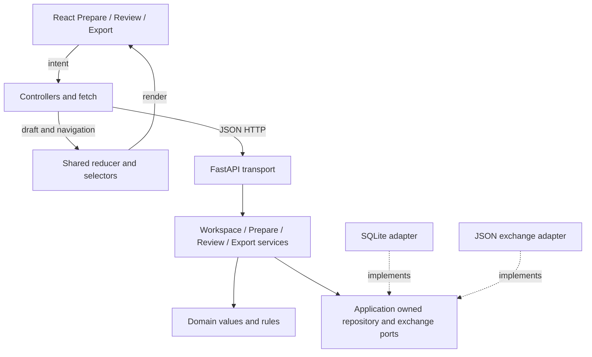

# Software architecture

The application is a local model/view/controller arrangement with one shared
client presentation model. The accepted study and rules live in Python, outside
the visual components. Both editable modules remain usable without IRCOMP.

Domain/application modules do not depend on FastAPI or concrete database/exchange
adapters. HTTP handlers normalize typed requests and errors; services own state
transitions. Strict frozen Pydantic models express values, while a dataclass
coordinates a process-local workspace. The same services run in headless tests.

## State ownership

| State | Owner and update |
| --- | --- |
| Accepted working study | Python WorkspaceSession; version-checked commands |
| Durable study and submitted editor buffers | SQLite; explicit atomic Save |
| Accepted-state mirror | Client reducer; replace from successful response |
| Typed strings and navigation | Shared client state; controlled input events |
| Counts and readiness | Derived domain projections/selectors |

DOM values never reconstruct the accepted model. Apply sends intent through the
controller and API, then a successful response updates every dependent panel.
One mutation is in flight per workspace. Editor generations protect newer typing
from a delayed response; uncertain command delivery requires state reconciliation.
Save clears one-step Undo. Restart recovery is limited to explicit durable saves.

## Module boundaries

Python paths are relative to `src/ircomp_gui`.

| Module | Client | Application and domain |
| --- | --- | --- |
| Prepare | `web/src/features/prepare/PrepareView.tsx` | `application/prepare.py`; target/context rules in `domain` |
| Review | `web/src/features/review/ReviewView.tsx` | `application/review.py`, `imports.py`; immutable evidence and separate membership decisions |
| Shared | `web/src/app` state/controllers; `web/src/shared`; Export view | `application/workspace.py`, `export.py`, `ports.py`; HTTP and concrete adapters |

Prepare changes targets/context; Review changes M:N memberships and decisions.
Export is shared rather than a third authored GUI module. A single-worker local
service serves the built client and API from one loopback origin. There is no
account system, distributed collaboration or scientific job execution.

Details: [model](domain-model.md), [API](api.md),
[exchange and storage](exchange-and-persistence.md),
[future IRCOMP boundary](ircomp-integration.md). The latter retains ownership,
missing specification fields and future acceptance gates. See
[verification](../verification.md) for exercised behavior and its limits.
