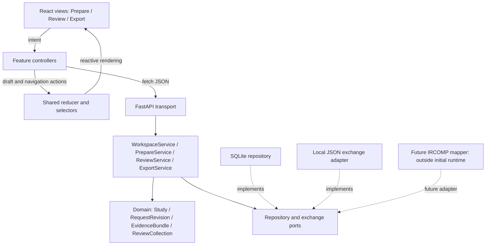

# Software architecture — S5

Status: local model/API, SQLite persistence and key React flows implemented.
S5 design recorded 1 November; S6 [verification](../development/s6-verification.md)
recorded 2 November 2026. Compiler integration remains deferred.

## Reading order

1. [Runtime decision](decisions/ADR-0002-local-runtime-and-state.md).
2. [Domain model and state](domain-model.md): identities, revisions, drafts, Undo.
3. [API](api.md): complete operation inventory and GUI connections.
4. [Exchange and persistence](exchange-and-persistence.md): exact import/export
   rules, reference catalogue, transactions and thesis boundary.
5. [S6 acceptance plan](s6-acceptance.md): implementation slices and observable checks.
6. [Machine-readable contracts](../../contracts/README.md): schemas and examples.
7. [IRCOMP integration and gaps](ircomp-integration.md): formal-language ownership,
   unsupported mappings and deferred capabilities; [ADR-0003](decisions/ADR-0003-ircomp-specification-boundary.md).

## Architecture and dependency direction

A model/view/controller arrangement with a shared client presentation model:
React renders state; feature controllers translate user intent into asynchronous
application calls; Python owns accepted data and domain rules. Components never
read values back from DOM elements to reconstruct the application model.



Runtime flow goes through adapters; code dependencies point toward application
ports and the domain. Domain modules import neither FastAPI, React nor SQLite.
Handlers translate typed requests/errors; they do not implement interval rules,
compatibility, collection membership or disposition completeness.

## Relationship to the formal specification language

The long-term frontend edits/views IRCOMP user specifications and presents
identified compiler products. Prepare is the initial editor of a restricted subset
of CRISPR intent. The current local Study/RequestRevision is a workspace model;
it is not IRCOMP's complete normalized request or canonical workflow IR.

IRCOMP owns the declarative language, authoritative structured request contract,
cartridge semantics, formal goals, planner, compiler, controller and execution.
Its inspected design selects YAML as the initial human-authored representation,
with syntax-independent normalized semantics; the exact product schema remains
provisional. IRCOMP-GUI owns local editing, persistence, presentation and review.

Future flow: **GUI Study/RequestRevision → versioned adapter → IRCOMP normalized
structured request → compiler**. The adapter must reject unsupported or unmappable
meaning with diagnostics, preserve identities/constraints and never infer missing
scientific policy. Workspace annotations remain separate and their exclusion is
disclosed. The [integration record](ircomp-integration.md) distinguishes object
kinds and validation authorities and records every currently missing field group.

No YAML editor, full specification schema, graph editor or compiler operation is
added to the current ITU API. These are gated future capabilities. Existing local
operations remain independently usable without a compiler.

## State ownership and reactive updates

| State | Owner | Lifetime / update |
| --- | --- | --- |
| Accepted working study | Python `WorkspaceSession` | Commands; lost on server restart until saved |
| Durable study + saved draft buffers | SQLite repository | Explicit atomic Save |
| Accepted-state mirror | Client reducer | Replace from successful server response |
| Input strings, dirty editor buffers | Client reducer | Each keystroke; submitted on Apply or Save |
| Selected target/revision/collection, filters, focus | Client presentation model | Navigation; no scientific meaning |
| Counts, readiness, incomplete decisions | Domain projections / client selectors | Derived; never independently writable |

Keep reducer, selectors, transport and controllers in ordinary TypeScript modules
outside view files. A Context provider supplies state and dispatch. Views receive
controlled values and issue intent events. Applying a decision replaces the
accepted mirror once: the candidate row, detail panel, collection count and
Export summary consequently render the same state without page reload.

Only one changing request is in flight per workspace. Typing may continue while
saving: compare the captured editor generation with the current generation before
clearing dirty state. A late response cannot overwrite newer typed text. Loading,
failure and stale-state messages are part of this presentation model.

## Module allocation

The following are implemented source boundaries. Source ownership/report author
labels still require the submission review; this table identifies responsibilities.

| Module | Views / controller / selectors | Application and domain |
| --- | --- | --- |
| A — Prepare | `web/src/features/prepare/PrepareView.tsx`; shared `app/controller.ts`, `app/selectors.ts` | `application/prepare.py`; `domain/models.py`, `domain/rules.py`, `domain/catalogue.py` |
| B — Review | `web/src/features/review/ReviewView.tsx`; shared controller/state | `application/review.py`, `application/imports.py`; immutable evidence and separate memberships in `domain/models.py` |
| Shared | `web/src/app/{App,WorkspaceProvider}.tsx`, `state.ts`, `controller.ts`, `selectors.ts`; `shared/api.ts`, `shared/ImportPreview.tsx`, `shared/types.ts`; `features/export/ExportView.tsx` | `application/workspace.py`, `application/export.py`, `application/ports.py`; `domain/serialization.py`; `api/app.py`, `api/requests.py`; `adapters/sqlite.py`, `adapters/exchange.py`, `adapters/resources.py` |

Python paths are relative to `src/ircomp_gui/`. Module A has substantive target and
context editing; Module B has many-to-many membership and editable decisions.
Shared export is not counted as a separate authored GUI module. The agreed solo
arrangement does not require inventing a second author.

## Apply → Save → reopen

```mermaid
sequenceDiagram
    participant V as Target editor
    participant M as Client presentation model
    participant A as Application service
    participant D as Domain
    participant R as SQLite repository
    V->>M: Change input strings
    V->>A: Apply target(draft, expected workspace version)
    A->>D: Validate and create next request revision
    alt Invalid draft
        D-->>M: Field diagnostics; accepted state unchanged
    else Accepted
        D-->>M: Working snapshot + new version + dirty state
        M-->>V: Re-render list, editor and summary
        V->>A: Save(current draft buffers, expected versions)
        A->>R: Compare saved version and commit whole snapshot
        R-->>M: Saved version, or failure with working state retained
        V->>A: Open saved study
        A->>R: Read and validate stored snapshot
        R-->>M: Accepted data + retained drafts
    end
```

## Runtime implementation notes

Strict frozen Pydantic value models own local data contracts; a dataclass owns the
working session coordinator. `Repository` and `ExchangePort` protocols belong to
`application/ports.py`; SQLite and JSON Schema implementations live in adapters.
Domain/application modules import neither FastAPI nor concrete adapters. Pure
bounded JSON handling stays in the domain; packaged metadata I/O stays in adapters.
The API assembly injects concrete implementations.

A local lock serializes workspace operations in this single-worker application.
Browser reload may reconnect to an existing session; explicitly opening a saved
study creates a separate copy. Leaving a working copy closes its owned session
and previews after confirmation. Export-last-saved may briefly open/read/close a
separate copy to identify the durable revision without changing working state.

## Scope and course mapping

| Course requirement | Design evidence | Runtime evidence |
| --- | --- | --- |
| Separate GUI / model | Component diagram and dependency rules | Headless domain/service tests |
| State outside visual elements | Shared reducer + authoritative domain session | Reactive updates across panels |
| Per-module classes, data, API | Allocation above and [operation tables](api.md) | Complete local operation inventory implemented |
| Asynchronous web interaction | Fetch boundary; versioned responses | Connected key flows without reload |
| Complete Phase I API | [Acceptance checklist](s6-acceptance.md) | Model/API, persistence and seven browser workflows pass |

S2 interviews may still change interaction priorities. The implementation must
keep input correction, exact evidence context and honest missing-data states.
