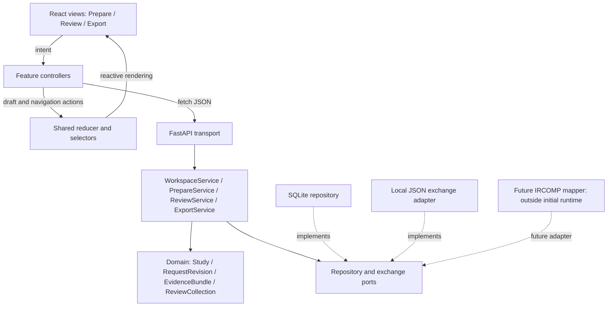

# Software architecture — S5

Status: implementation specification, 1 November 2026. The schemas and fixtures
are design artifacts; application services, persistence and GUI remain S6 work.
This record supports ITU report §4, not evidence that the API already exists.

## Reading order

1. [Runtime decision](decisions/ADR-0002-local-runtime-and-state.md).
2. [Domain model and state](domain-model.md): identities, revisions, drafts, Undo.
3. [API](api.md): complete operation inventory and GUI connections.
4. [Exchange and persistence](exchange-and-persistence.md): exact import/export
   rules, reference catalogue, transactions and thesis boundary.
5. [S6 acceptance plan](s6-acceptance.md): implementation slices and observable checks.
6. [Machine-readable contracts](../../contracts/README.md): schemas and examples.

## Architecture and dependency direction

A model/view/controller arrangement with a shared client presentation model:
React renders state; feature controllers translate user intent into asynchronous
application calls; Python owns accepted data and domain rules. Components never
read values back from DOM elements to reconstruct the application model.



Runtime flow goes through adapters; code dependencies point toward application
ports and the domain. Domain modules import neither FastAPI, React nor SQLite.
Handlers translate typed requests/errors; they do not implement interval rules,
compatibility, collection membership or disposition completeness.

## State ownership and reactive updates

| State | Owner | Lifetime / update |
| --- | --- | --- |
| Accepted working study | Python `WorkspaceSession` | Commands; lost on server restart until saved |
| Durable study + saved draft buffers | SQLite repository | Explicit atomic Save |
| Accepted-state mirror | Client reducer | Replace from successful server response |
| Input strings, dirty editor buffers | Client reducer | Each keystroke; submitted on Apply or Save |
| Selected target/revision/collection, filters, focus | Client presentation model | Navigation; no scientific meaning |
| Counts, readiness, incomplete decisions | Domain projections / client selectors | Derived; never independently writable |

Keep reducer, selectors, transport and controllers in ordinary TypeScript modules
outside view files. A Context provider supplies state and dispatch. Views receive
controlled values and issue intent events. Applying a decision replaces the
accepted mirror once: the candidate row, detail panel, collection count and
Export summary consequently render the same state without page reload.

Only one changing request is in flight per workspace. Typing may continue while
saving: compare the captured editor generation with the current generation before
clearing dirty state. A late response cannot overwrite newer typed text. Loading,
failure and stale-state messages are part of this presentation model.

## Module allocation

These are intended source files, not an inventory of implemented code or student
authorship. Create each with its behavior; record actual files in the final report.

| Module | Views / controller / selectors | Application and domain |
| --- | --- | --- |
| A — Prepare | `web/src/features/prepare/{PrepareView,TargetEditor,TargetList,ProblemList}.tsx`; `controller.ts`, `selectors.ts` | `application/prepare.py`: apply/remove target, context, labels, validation; `domain/request.py`: revisions, intervals, catalogue checks |
| B — Review | `web/src/features/review/{ReviewView,EvidencePreview,CandidateDetails,CollectionEditor}.tsx`; `controller.ts`, `selectors.ts` | `application/review.py`: preview/attach, collections, membership, decisions; `domain/evidence.py`, `domain/review.py`: immutable observations and editable review layer |
| Shared | `web/src/app/{App,WorkspaceProvider}.tsx`, `state.ts`, `controller.ts`; `web/src/shared/api.ts`; `features/export/` | `application/workspace.py`, `application/export.py`, `application/ports.py`; `domain/study.py`, `domain/diagnostics.py`; `api/`; `adapters/sqlite.py`, `adapters/exchange.py` |

Python paths are relative to `src/ircomp_gui/`. Module A has substantive target and
context editing; Module B has many-to-many membership and editable decisions.
Shared export is not counted as a separate authored GUI module. The agreed solo
arrangement does not require inventing a second author.

## Apply → Save → reopen

```mermaid
sequenceDiagram
    participant V as Target editor
    participant M as Client presentation model
    participant A as Application service
    participant D as Domain
    participant R as SQLite repository
    V->>M: Change input strings
    V->>A: Apply target(draft, expected workspace version)
    A->>D: Validate and create next request revision
    alt Invalid draft
        D-->>M: Field diagnostics; accepted state unchanged
    else Accepted
        D-->>M: Working snapshot + new version + dirty state
        M-->>V: Re-render list, editor and summary
        V->>A: Save(current draft buffers, expected versions)
        A->>R: Compare saved version and commit whole snapshot
        R-->>M: Saved version, or failure with working state retained
        V->>A: Open saved study
        A->>R: Read and validate stored snapshot
        R-->>M: Accepted data + retained drafts
    end
```

## Scope and course mapping

| Course requirement | Design evidence | Runtime evidence still needed |
| --- | --- | --- |
| Separate GUI / model | Component diagram and dependency rules | Headless domain/service tests |
| State outside visual elements | Shared reducer + authoritative domain session | Reactive updates across panels |
| Per-module classes, data, API | Allocation above and [operation tables](api.md) | Implement every declared operation |
| Asynchronous web interaction | Fetch boundary; versioned responses | Connected key flows without reload |
| Complete Phase I API | [Acceptance checklist](s6-acceptance.md) | Passing model, API, persistence and GUI checks |

S2 interviews may still change interaction priorities. The implementation must
keep input correction, exact evidence context and honest missing-data states.
