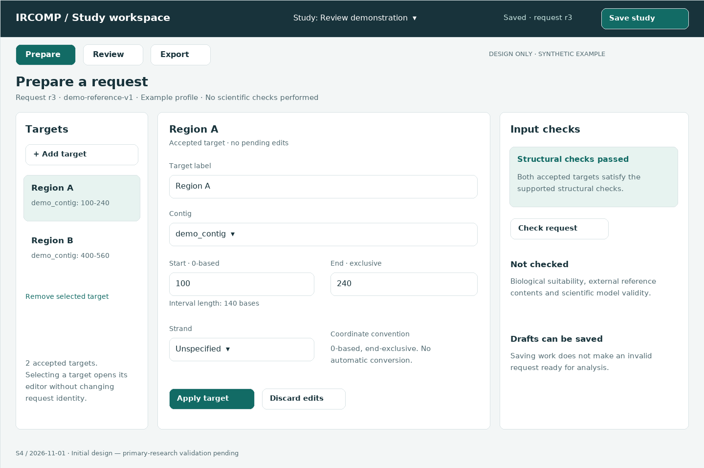
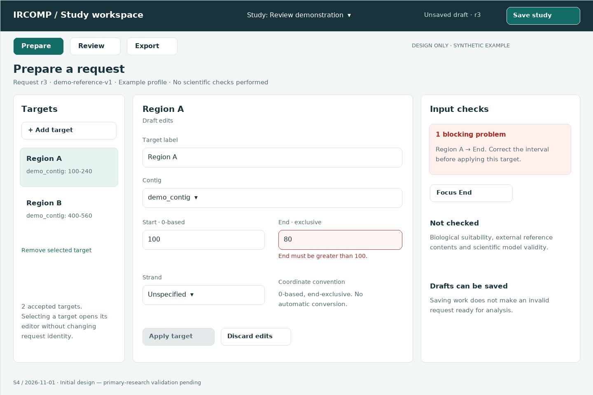
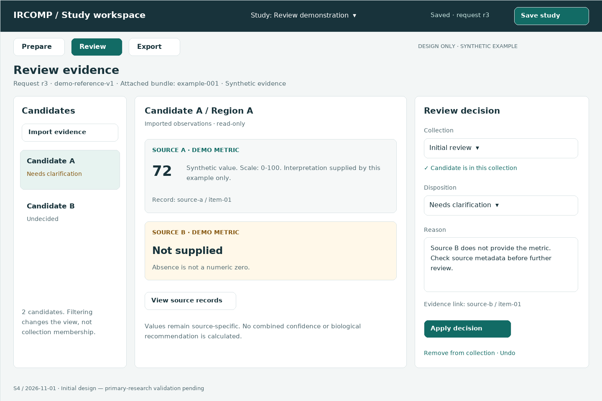
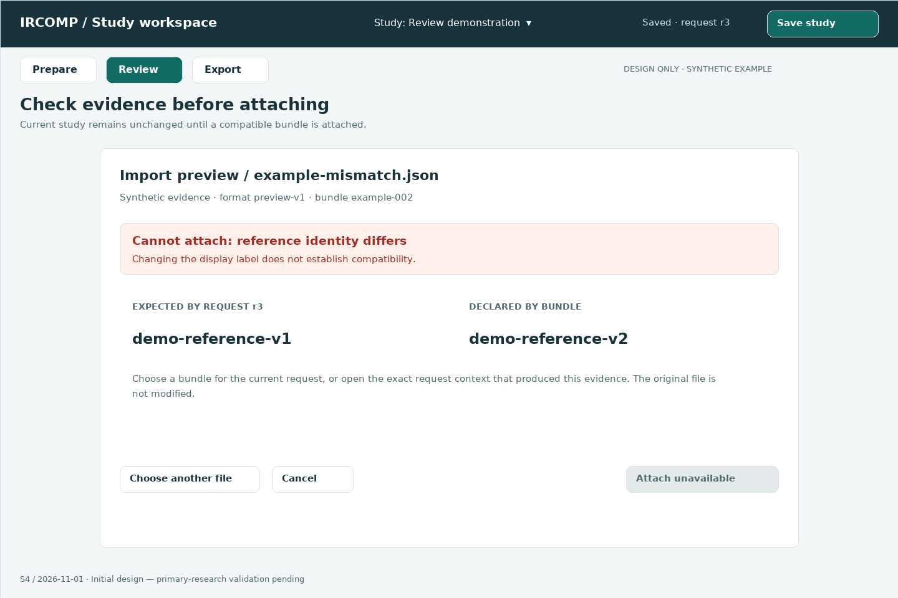
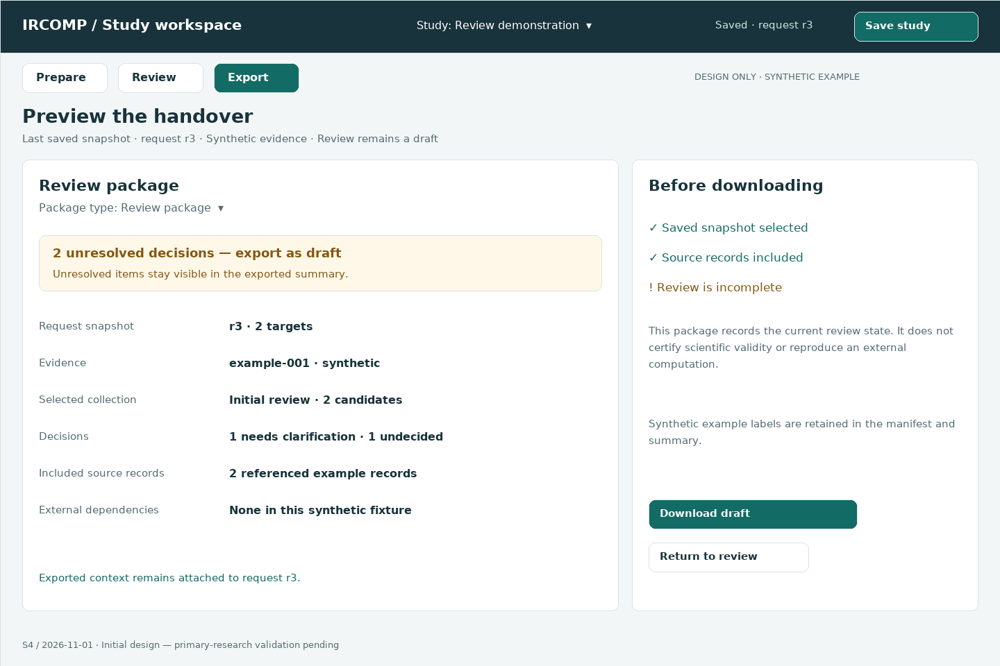

# UI design

[S4 specification](s4-ui-design.md) owns the navigation, data/operation mapping,
editing scenarios, state transitions and accessibility requirements.

The five wireframes are static design artifacts, not a runnable application.
Every example is synthetic. SVG files are editable vector sources; PNGs provide
portable previews for review and report preparation.

| View | Preview | Editable vector | Purpose |
| --- | --- | --- | --- |
| Prepare | [PNG](wireframes/01-prepare.png) | [SVG](wireframes/01-prepare.svg) | Target editing and scoped checks |
| Prepare error | [PNG](wireframes/02-prepare-error.png) | [SVG](wireframes/02-prepare-error.svg) | Invalid draft and field-focused recovery |
| Review | [PNG](wireframes/03-review.png) | [SVG](wireframes/03-review.svg) | Immutable evidence beside editable decisions |
| Import mismatch | [PNG](wireframes/04-import-mismatch.png) | [SVG](wireframes/04-import-mismatch.svg) | Transactional preview and incompatible context |
| Export | [PNG](wireframes/05-export.png) | [SVG](wireframes/05-export.svg) | Contents, unresolved decisions and draft status |

## Prepare



## Correct a draft



## Review evidence



## Inspect an incompatible import



## Preview an export



## Editing and rendering

The maintained drawing source is
[`render_wireframes.py`](../../scripts/development/render_wireframes.py).
Edit that script and regenerate both formats together from the repository root:

```sh
python scripts/development/render_wireframes.py
```

Requires Pillow and the DejaVu Sans regular/bold fonts at the paths declared in
the renderer. These are authoring dependencies, not application dependencies.
The renderer wraps paragraphs and rejects text that extends beyond the frame.
SVG text uses DejaVu Sans with a sans-serif fallback; an unavailable font can
change vector text metrics. PNG previews preserve the inspected rendering.

Visual review checked all five frames for clipping, readable labels and alignment.
The invalid-draft frame explicitly differs from the saved request in the list.
No keyboard, screen-reader, responsive or user-task test has been performed on a
real GUI; those checks belong to implementation and later usability testing.

Rendering environment inspected: Python 3.14.6, Pillow 12.3.0; Linux DejaVu Sans.
