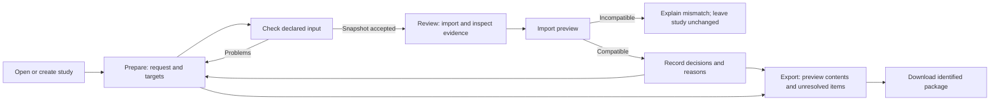

# S4 — Interface design

Date: 2026-11-01

Status: Initial wireframe design. Primary-research validation pending.

## Design objective

Prepare a small, explicit analysis request and turn imported observations into
an explainable review. Keep reference identity visible, make corrections local,
and preserve the distinction between source evidence and reviewer judgment.

The two substantive modules are **Prepare** and **Review**. **Export** is their
shared handover view. The interface does not initiate scientific execution.
Examples in the wireframes are synthetic and show interface states only.

The structure follows provisional needs N1–N8 in
[S2](../research/s2-desk-research.md) and the lessons in
[S3](../research/s3-competitive-analysis.md). It is not a claim that interviews
confirmed the design. English is the initial UI language; Czech report text can
describe the same controls without maintaining a second UI vocabulary.

## Information architecture

Prepare and Review remain available from the same shell. Review can explain an
empty state before evidence is attached. Navigation does not create a request
revision, execute an analysis, discard form edits, or silently save them.

## Common shell

- Top bar: application name, study selector, study title, save state, Save study.
- Second row: Prepare / Review / Export, with text identifying the active view.
- Context strip: request revision, reference profile and evidence category.
- Main area: task-specific content with linked selection and details.
- Persistent prototype label in the artifacts; example-data label remains part
  of the real application whenever synthetic evidence is loaded.

Save state is explicit: Saved, Unsaved changes, Saving, or Save failed. Errors
remain visible until resolved. Successful save does not imply that inputs are
scientifically suitable. A draft can be saved while validation problems remain.

The study selector opens an inline list with New, Open, Rename and Duplicate.
Duplicate copies the editable request into a new study identity; it does not
silently claim existing evidence belongs to that identity. Evidence reuse needs
an explicit compatibility check. Delete-study handling is outside the initial
declared operations; target and collection removal remain supported.

## Module A — Prepare

### Display and operations

| Area | Data shown | Operations |
| --- | --- | --- |
| Target list | Label, contig/interval summary, validation status | Add, select, remove; selection changes the editor |
| Request context | Reference profile, accession/version, analysis profile | Inspect details; choose a supported profile |
| Target editor | Label, contig, start, end, coordinate convention, strand | Edit draft; Apply target; Discard edits |
| Check panel | Problems grouped by target/field; checks not performed | Run checks; focus the corresponding field |
| Request summary | Target count, accepted revision, export readiness | Save draft; open Export |

Use one documented coordinate convention for manual entry in the first version:
**0-based, end-exclusive**. Repeat this beside the interval controls and in exports.
The source importer must require a declared convention; it cannot infer one from
numbers. The [S5 catalogue](../../contracts/catalogue.json) specifies supported
profiles and contig bounds: a synthetic reference and an explicit 24-chromosome
GRCh38.p14 subset. Wireframes remain synthetic examples. Catalogue metadata does
not establish that a reference sequence file was checked.

The left list preserves orientation during editing. The middle editor keeps
related fields together. The right panel links a problem to the exact input,
following N2/N4 and CR-P1/CH-P1. On smaller screens these become stacked regions.

### Edit and revision behavior

Input typing updates a draft buffer. Apply target accepts the edited target into
the in-memory study when local structural checks pass; Save study persists it.
Invalid draft text remains visible and is never converted to an accepted value.
Selecting a different target with unaccepted edits offers Apply, Discard or Stay.
Apply remains unavailable while structural errors exist, with a textual reason.

Adding/removing a target or changing accepted analysis context produces a new
request revision. Cosmetic study/target labels do not invalidate scientific
context. Repeated keystrokes do not create revisions. Existing evidence remains
bound to its original revision; a context change explains the consequence before
acceptance. [S5 state rules](../architecture/domain-model.md) specify the exact
revision boundary, separately saved draft buffers and one-step Undo. Save clears
Undo history; imported evidence retains its original revision.

Remove target uses an inline confirmation naming the target and explaining any
evidence association. Undo restores the previous in-memory state; save/reopen
semantics must preserve identity rather than assign new scientific meaning.

### Scenario A1 — repair an interval

1. Open a saved study and add a target.
2. Enter an end smaller than the start; the draft displays a field error.
3. The check-panel entry focuses End. Other target data remain intact.
4. Correct the end and apply. Target summary and problem count update together.
5. Save. The save indicator changes only after persistence succeeds.

Expected state changes: draft → accepted target → new request revision → persisted
study. The warning disappearing proves the specific structural check passed,
not that the biological question is valid.

## Module B — Review

### Display and operations

| Area | Data shown | Operations |
| --- | --- | --- |
| Evidence header | Bundle ID, request revision, declared source context | Import bundle; inspect manifest |
| Candidate list | Candidate ID/label, target, review disposition | Select candidate; filter view without changing membership |
| Evidence detail | Source-specific metrics, raw values, availability, source record | Inspect original data and declared metadata |
| Review panel | Collection, disposition, reason, evidence references | Add/remove member; change decision; save reason |
| Collection controls | Default and additional named collections, member count | Create, rename, remove collection; undo removal |

One default collection is ready at first use. Additional collections are secondary
controls; a candidate can belong to more than one, with a decision scoped to each
membership. Removing membership does not delete imported evidence. Removing a
collection names the affected decision count and offers Undo.

Selecting a candidate updates its detail and review panel together. Decisions
are **Undecided**, **Include for further review**, **Exclude**, or **Needs
clarification**. No disposition is named Approved or Safe. Reasons are editable
plain text. Non-undecided decisions without a reason remain visibly incomplete;
draft export is allowed and carries the unresolved marker. This avoids blocking
work while preventing an empty rationale from appearing finished.

Source observations are read-only. Each metric retains its name, source/model,
raw value, scale/direction where known, and availability status. Missing metadata
is displayed as unknown. No combined score or automatic ranking is introduced.
Matching records across sources requires the declared identity contract; ambiguous
matches remain separate. Example metrics are labelled as synthetic demonstrations.

This layout follows N1/N3/N8 and CR-P2/BE-P2: retain context while moving from
inspection to a separate human decision. Color supplements text, never replaces it.

### Import preview and failure

File selection first creates a temporary preview. Show filename, format version,
bundle identity, evidence category and declared request/reference identity before
attachment. Compare declared values side by side. Compatibility is a scoped
application check, not verification of the external computation.

Attach is disabled for malformed or incompatible input. Cancel leaves accepted
study state unchanged. A bundle for an older request may be attached to that exact
available revision through an explicit choice; it is not relabelled as current.
Unknown compatibility remains unresolved, with a specific missing-field message.
An already attached identical bundle is identified; do not silently duplicate it.

### Scenario B1 — inspect and decide

1. Preview a compatible synthetic bundle and attach it to request revision 3.
2. Select a candidate. Distinct source observations appear beside the decision.
3. Add the candidate to the default review collection.
4. Choose Needs clarification, record a reason and link a source record.
5. Apply decision. List disposition and collection summary update together.
6. Save and reopen. The decision and original evidence association remain intact.

### Scenario B2 — incompatible reference

1. Select a bundle declaring `demo-reference-v2` while the request uses v1.
2. Preview shows Expected / Received and explains the mismatch.
3. Attach is unavailable; Cancel preserves the previous evidence and decisions.
4. Obtain a matching bundle or select its actual request context. Editing a label
   to force a match is not offered as a repair.

## Shared view — Export

Choose **Request snapshot** or **Review package**. The preview enumerates request
revision, targets, evidence records, collections, decisions, unresolved items and
external dependencies. Review-package export requires accepted attached evidence;
request export does not. Unsaved or unapplied edits require Save/Apply or an
explicit choice to export the last saved snapshot, whose identity is shown.

Draft saving and draft review export are supported. Request snapshots with
structural errors cannot be exported as ready-to-use requests. A review with
unresolved decisions can be exported as a **Draft review**. The file manifest and
human summary preserve that state; clicking Download is not an approval action.

Only the selected collections are included. Preview counts are recalculated from
the same selection. Include original evidence records needed to interpret those
decisions and their external dependency declarations. The [S5 exchange contract](../architecture/exchange-and-persistence.md)
selects `.request.json` and `.review.json`, including complete original source
bytes in review packages. Export uses an explicitly selected saved snapshot;
unapplied draft buffers are excluded with a visible notice.

## State coverage

| State | Display and recovery | Model effect |
| --- | --- | --- |
| New study | Empty target list; Add target call to action | None until accepted edit |
| No evidence | Explain import format and offer labelled example | No invented execution result |
| Loading/opening | Region status; prevent conflicting operation | Preserve current accepted state until success |
| Invalid draft | Field message + problem link; retain input | No accepted update |
| Save failed | Persistent error, Retry; retain unsaved changes | Last saved version remains available |
| Import malformed | Parse/version diagnostic; choose another file | No partial attachment |
| Import incompatible | Expected/received context; Cancel | No accepted mutation |
| Valid empty bundle | No candidate records supplied | Import status distinct from scientific search outcome |
| Missing metric | Not supplied / unsupported / unknown, as evidenced | Raw source record unchanged |
| Older evidence | Original revision visible; return to that revision | No silent reassociation |
| Removal | Named confirmation; Undo feedback | Reversible accepted edit |
| Export failed | Error with Retry; preview retained | Study unchanged |

## Interaction and visual rules

- Desktop reference layout: 1440 × 960; readable three-region working area.
  Below approximately 1100 px, diagnostics move below the editor. At narrow
  widths, stack list/editor/details in reading order rather than compress fields.
- Use semantic headings, labelled inputs and native controls. Tables have header
  cells; selection works with keyboard controls and a visible focus indicator.
- Tab order follows navigation → list → editor/details → actions. Error links
  focus fields. Save outcomes use a polite status announcement; blocking errors
  use an appropriate alert. Never move focus just because a background check ran.
- Provide text with every status color. Maintain readable contrast; verify the
  implemented interface with keyboard navigation and contrast checks in S6.
- Main actions use verbs: Add target, Apply target, Import evidence, Apply decision,
  Save study, Download draft. Avoid generic OK where the action changes data.
- Use inline panels for ordinary edits. Reserve modal confirmation for leaving
  unsaved work or destructive actions where a contextual inline control is unclear.
- Font stack: system UI; monospace for accessions and coordinates. Restrained teal
  action accent, neutral surfaces, amber unresolved states and red blocking errors.

## Review scenarios and open decisions

The initial design is ready for walkthrough, not claimed usable by measurement.
Observe preparation, error correction, score interpretation, decision recovery
and export explanation with real users later. Record independent completion,
assistance, interpretation errors and recovery; no fabricated success rate.

- [ ] S2: confirm that interval entry fits the actual operator's starting data.
- [ ] S2: determine whether candidate-level decisions and multiple collections
      match the actual decision granularity.
- [x] S5: specify identity, revision, compatibility and import transaction rules.
- [x] S5: define export schema and exactly which raw records are included.
- [ ] S6: implement all declared operations, keyboard/focus behavior and recovery.
- [ ] Report: review the design and required author labels before incorporating
      the wireframes into the assessed report.

The wireframes cover both modules and shared export; the state table specifies
additional states without implying all of them have separate screen artwork.
