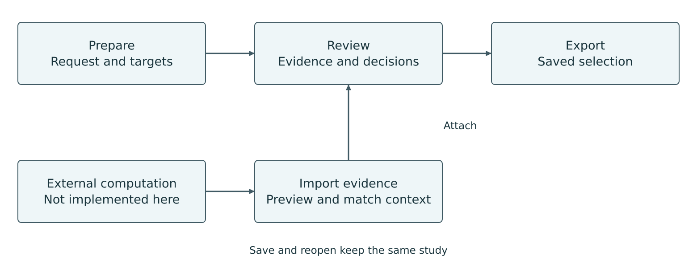
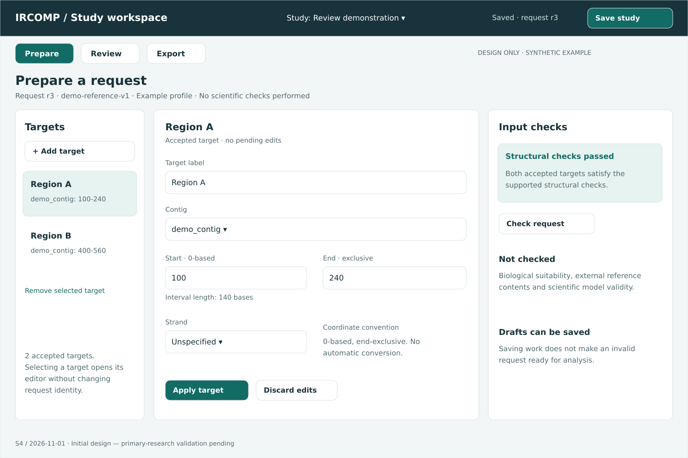
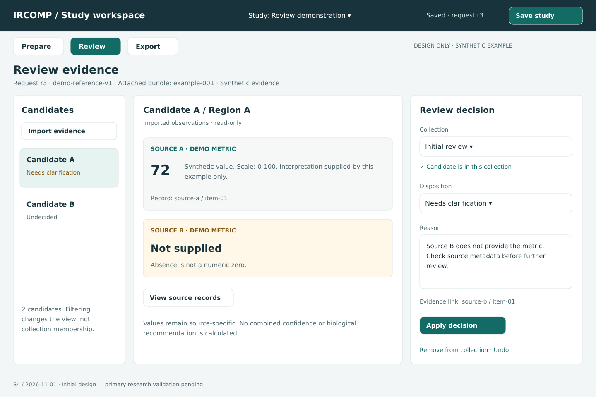
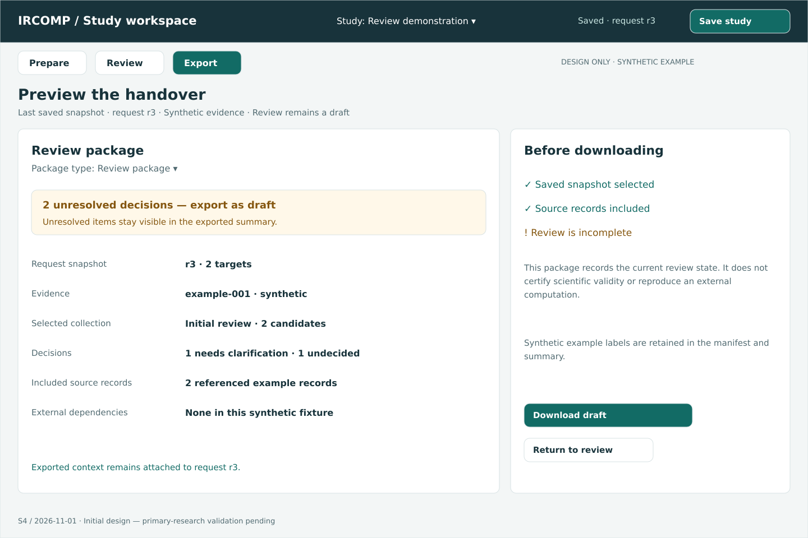
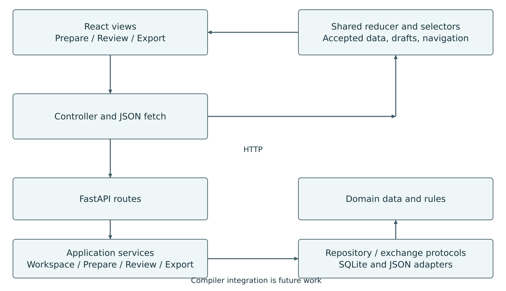

# CRISPR Study Workspace

Phase I design report for ITU 2026

Name: Lukas (Viridis) Dubsik
Login: xdubsil00
Project: IRCOMP
School-Project: ITU-1
Lab day and time: not recorded
Report date: 6 November 2026

## Project topic

IRCOMP-GUI is a local application for preparing CRISPR analysis requests and reviewing imported evidence. It is also an initial interface for the larger IRCOMP project. The standalone application has two editable modules: Prepare changes request targets and reference context, while Review manages candidate collections and decisions. Export provides their common file output.

The intended user is a computational biologist, bioinformatician or research assistant working with analysis inputs and results. An experimental collaborator may receive the selected candidates. These roles are the starting assumption; real interviews still need to check the actual workflow.

The application supports editing, local validation, SQLite storage and JSON exchange. CRISPR scoring, biological validation and the IRCOMP compiler are not implemented. The local request file is separate from IRCOMP's future specification language.

Solo participation was agreed beforehand. The chosen scope covers two modules and two planned research sessions. This is a voluntary workload choice; the assignment requires at least one real user per actual team member.

Code and documentation were developed with AI assistance, including core functionality. The contribution record is in ai-audit.md. Pending actions and the editable lab field are in the temporary README checklist.

<!-- page -->

## Contents

<!-- contents -->

<!-- page -->

## 1 User research

### 1.1 Research completed so far

The secondary research recorded on 1 November 2026 covers 16 sources: seven public discussions or issue reports, six documentation sources and three original papers. It looks at score interpretation, reference identity, input correction, returning to earlier work and handing over results. The full E01-E16 register and interview plan are kept in Confluence [14].

A discussion describes the experience of its author, not how often a problem occurs. Documentation describes a tool, but does not prove that users have difficulty with it. The needs below are interpretations of these sources and have not been confirmed by interviews.

For example, a discussion compares different scores for the same CRISPR sequences [4]. CRISPOR issue 69 was resolved after correcting a reference identifier from h38 to hg38 [5]. A Galaxy Help discussion concerns inconsistent chromosome names [6]. CHOPCHOP documents score interpretation and advanced settings [8]. These are reasons to investigate context and interpretation; they are not evidence that every current tool has the same problem.

There is also evidence against adding another application. Some users already work well in integrated environments, and some computational users prefer a terminal. The GUI must offer enough value to justify converting data into its local format. Candidate-level decisions and multiple collections are still weakly supported assumptions.

### 1.2 Real sessions still to complete

No completed primary sessions are recorded in this report. P01 and P02 are planned sessions, not research results. The proposed interview takes 35-45 minutes: discuss a recent task, walk through the files and tools, examine identity and handover, then show the concept at the end.

| Session | Information to add after the actual meeting |
| --- | --- |
| P01 | Not conducted; participant and session details are not recorded |
| P02 | Not conducted; participant and session details are not recorded |
| Observation | No primary observations recorded |
| Evaluation | No primary-session evaluation recorded |

Use exact quotations only where a permitted record supports them. The research guide [3] recommends open questions about past work rather than asking whether the participant likes a proposed feature.

<!-- page -->

### 1.3 Working user needs

These are human and process needs inferred from secondary research. They describe what the person needs to achieve and why. Specific application functions are discussed later, in the UI design.

| ID | Working need | Evidence and remaining uncertainty |
| --- | --- | --- |
| N1 | Understand where an observation came from and what it means, so different metrics are not treated as the same quantity. | E01, E08, E09, E14; moderate secondary support |
| N2 | Identify the target, reference and coordinate convention, so the result belongs to the correct input. | E02-E04, E11; strong technical basis |
| N3 | Distinguish missing information from an unfavourable value, and file acceptance from completed analysis. | E08-E10; documented examples |
| N4 | Find and correct input problems without losing already completed work. | E03, E04, E10; specific issue reports |
| N5 | Recover the inputs and evidence behind an earlier decision when returning to the task. | E06, E15; transfer to this workflow unconfirmed |
| N6 | Pass a selection to another person with enough context to understand unresolved questions. | E08, E12; actual handover format unconfirmed |
| N7 | Use the tool within existing work without unnecessary conversion or repeated input. | E05, E07, E13, E16; also an argument against another GUI |
| N8 | Keep the reason for including, excluding or postponing a candidate. | Weak direct evidence; decision granularity needs an interview |

Support here describes the basis for a problem or technical rule, not its frequency. E identifiers refer to the research register [14].

### 1.4 How the interviews will change the design

The links between working needs and actual P01/P02 findings are not yet recorded. Observed steps, effects and design interpretations remain separate categories. The research actions are listed in the temporary README checklist.

The main questions are whether the user starts with intervals, decides about individual candidates, needs alternative collections and can provide the expected metadata without much extra work. If an existing notebook or script already solves the problem, the scope should be reduced or the existing handover reused.

Any findings must also update the competitor comparison, interaction scenarios and priorities. Later usability testing will cover target entry, correction, zero versus absence, revision matching, a review decision and explaining the export. Engineering checks do not replace those sessions.

<!-- page -->

## 2 Existing applications

### 2.1 Method

The comparison recorded on 1 November 2026 covers CRISPOR, CHOPCHOP, Benchling and Galaxy. CRISPOR and CHOPCHOP are direct domain alternatives. Benchling is an integrated laboratory environment; Galaxy is a broader environment for organising analyses. O means observed public UI, D documented behaviour, and I design interpretation. No scientific calculation or task timing was performed. N1-N8 remain provisional until the interviews.

### 2.2 CRISPOR

The inspected material was the public input form, labelled version 5.2, and the official manual [7].

| Item | Observation or interpretation | Needs |
| --- | --- | --- |
| Pro 1 O | Three numbered groups bring the target, genome and PAM together. | N2, N7 |
| Pro 2 D | Links connect the annotated sequence to candidate rows. | N1, N2 |
| Pro 3 D | Results can be downloaded for later work and storage. | N5, N6 |
| Con 1 D/I | A remembered genome needs to be checked as inherited context. | N2, N4 |
| Con 2 O/I | The main form limits a single sequence to under 2300 bp; batch input is separate. | N7 |
| Con 3 D/I | Long-term retention requires the user to download the result deliberately. | N5, N6 |

For this project, the useful parts are common context and a connected detail view. Saved work should be clearly distinguished from temporary results. This comparison does not establish that CRISPOR lacks every annotation or batch option.

### 2.3 CHOPCHOP

The inspected material was the public form with Options expanded and the official instructions [8].

| Item | Observation or interpretation | Needs |
| --- | --- | --- |
| Pro 1 O | Target, organism, tool and purpose are shown together. | N2, N7 |
| Pro 2 O | Options group advanced choices into tabs. | N7 |
| Pro 3 O | Input supports identifiers, coordinates and pasted sequence. | N2, N7 |
| Con 1 D/I | Advanced settings may remain after a mode change. | N2, N4 |
| Con 2 D/I | A zero can have different meanings depending on the metric and settings. | N1, N3 |
| Con 3 O/I | Expanded options require many domain decisions. | N4, N7 |

Advanced options can be hidden initially, but the settings that are actually applied must remain visible. Keep an original zero and its source meaning. The estimated decision burden is an interpretation, not a measured usability failure.

<!-- page -->

### 2.4 Benchling

This comparison uses the documented CRISPR procedure updated on 26 September 2024 [9]. A signed-in application was not inspected. Functional descriptions therefore have level D.

| Item | Documented behaviour or interpretation | Needs |
| --- | --- | --- |
| Pro 1 D | Import, analysis and saved results belong to one environment. | N5, N7 |
| Pro 2 D | Split Workspace connects table selection to sequence context. | N1, N2 |
| Pro 3 D | All guides or a selected set can be exported. | N6, N7 |
| Con 1 D/I | The described procedure assumes an account and Benchling workspace. | N7 |
| Con 2 D/I | Preparation moves between import, parameters and analysis. | N2, N7 |
| Con 3 D/I | The documented notebook transfer uses TSV and manual table insertion. | N6, N8 |

Related objects should stay together, with context and decisions visible before export. The disadvantages concern the documented procedure, not every product capability. Its integrated environment is also a reason to question whether another organiser is needed.

### 2.5 Galaxy

The inspected material was the anonymous Galaxy Europe interface and official history/workflow tutorials [10, 11].

| Item | Observation or interpretation | Needs |
| --- | --- | --- |
| Pro 1 D | Histories organise work, annotations and tags. | N5, N8 |
| Pro 2 D | Workflows and tools have traceable versions. | N5 |
| Pro 3 D | Histories can be archived and shared. | N6 |
| Con 1 O/I | General catalogue and navigation exceed the narrow review task. | N7 |
| Con 2 D/I | Workflow context, tool versions and history are in different places. | N2, N5 |
| Con 3 O | The anonymous session on the inspected server limits history management. | N5, N7 |

The useful principle is traceability, while the scope can remain much smaller. An anonymous-session restriction is not a property of every Galaxy deployment.

### 2.6 Lessons for the application

The comparison supports visible request context, connected panels, an explicit save state and exports that preserve their source information. The benefit of another file format and candidate collections is less certain. The interviews must decide whether those parts help the actual workflow.

These tools perform work that IRCOMP-GUI does not perform. Reusing an interaction does not give the prototype their scientific capabilities.

<!-- page -->

## 3 Interface design

### 3.1 Main views and data

Prepare handles entering and correcting the request (N2, N4). Review handles interpreting imported evidence and recording a separate decision (N1, N3, N8). Export provides saved context for handover (N5, N6). A common strip shows the reference, profile, selected revision and save state.



Changing a view does not reload the page. Selecting a historical revision changes what is displayed, while edits still address the active request. Computation is outside the application and is not represented by a working Run button.

| Data shown | Operations that change the model |
| --- | --- |
| Study, targets, reference, profile and intervals | Create, rename or duplicate a study; add/edit/remove targets; explicitly replace context |
| Evidence identity and contents | Inspect a file and attach it to matching context; original bytes stay unchanged |
| Collections and candidate decisions | Create a collection, change membership, set a disposition, reason and supporting references |
| Working and saved state | Save, restore one accepted action with Undo, reopen and prepare an export |

Filtering and selecting items are supporting interactions. The two main editable modules change request data and collection membership/decisions.

Errors remain near the input and use text as well as colour. On narrow screens the panels stack. Extra collections and technical details are secondary to completing the first useful decision. The clarity of this arrangement still needs real-user testing.

<!-- page -->

### 3.2 Prepare

The view contains a target list, editor and checks. The list keeps other targets visible while one is edited. Reference and profile apply to the whole request. Coordinate fields state the zero-based, end-exclusive convention directly.



The complete editable source is `docs/design/wireframes/01-prepare.svg`. This is an initial design image with synthetic input, not a capture of the finished application.

Scenario A: create a study, add two targets and edit an interval. Typing changes the editor text first. Apply parses and validates it, then changes the accepted request. An analytical change creates a revision and updates the list, summary and export readiness. Renaming a target alone keeps the revision.

Scenario B: enter an invalid interval end. Accepted data stays unchanged; the diagnostic identifies the input. The user can correct the existing text. Save can also preserve an invalid unapplied draft for recovery, but that draft does not enter an export.

Scenario C: change the reference or profile. This requires an explicit replacement of the whole context and valid intervals, with the same target IDs. There is no hidden coordinate conversion. Earlier evidence stays attached to its original revision. Catalogue bounds do not verify an external FASTA file or biological suitability.

<!-- page -->

### 3.3 Review

The candidate list chooses the immutable detail. The decision editor belongs to the selected collection. The user can record an interpretation without replacing the original observation. Figure 3 shows the decision part of the initial wireframe.




The full source is `docs/design/wireframes/03-review.svg`. Source scores are kept separately. No mean or universal confidence percentage is calculated. Zero is a value; absence is a different state.

Scenario D: inspect evidence before attaching it. The preview shows expected and received context, source and category. Acceptance requires the request ID and complete selected revision to match. Renaming the reference cannot repair a mismatching file. Failure does not partly attach the bundle.

Scenario E: add a candidate to a collection, choose undecided, include for review, exclude or needs clarification, and enter a reason. Apply changes the decision, list status and unfinished count. Another collection can hold a different decision about that same candidate.

Scenario F: remove a membership by mistake, then use Undo. Only the review layer changes; original evidence is retained. Save keeps the study and separate draft text for reopening. A review disposition is not experimental approval or permission to execute a workflow.

<!-- page -->

### 3.4 Export and recovery

Export uses the saved request and selected collections. The preview states the save counter, request revision, source records, dependencies and unresolved decisions. Once prepared, its bytes remain fixed even if a later Save occurs.



With unsaved work, use Save or explicitly choose Export last saved. A request export contains one revision, not all workspace history or editor buffers. A review package includes selected decisions and complete source files needed by them. Reviewed means the decision records are complete; it is not scientific approval.

| Situation | Response |
| --- | --- |
| Empty study or no evidence | Explain the next step; show no invented calculation |
| Invalid input | Identify the field and retain the typed text |
| Save failure | Keep working changes; report success only after storage succeeds |
| Changed import context | Check again against the selected revision before attaching |
| Lost command response | Refresh working state and inspect accepted changes before retrying |
| Historical evidence | Show its original revision; do not relabel it as current |

Native labelled controls support keyboard input and visible focus. Routine checks do not move focus without an action. Engineering checks are described later; no full accessibility audit or completed usability study is claimed.

<!-- page -->

## 4 Software architecture

### 4.1 Views and application data

React renders the shared client state. The controller translates user actions into asynchronous HTTP requests. Python services and domain classes own accepted data and rules. FastAPI handles transport; SQLite and JSON handling implement the storage and exchange protocols.



Domain and application modules do not import React, FastAPI or the concrete SQLite adapter. They can be used directly from Python. The arrows show calls; the protocols belong to the application layer and are implemented by the adapters.

| State | Where it is kept |
| --- | --- |
| Accepted working study | Python Session, with one local lock ordering operations |
| Saved study and submitted editor text | SQLite, after explicit Save |
| Client copy of accepted data | Shared reducer, replaced from a successful response |
| Typed text and navigation | Shared client state updated by input events |
| Counts and readiness | Calculated from data, not stored as independent values |

An Apply action goes through controller, API and model. The returned state updates all dependent panels. A small editor counter prevents a delayed Save response from erasing newer typing. DOM attributes are not the source of accepted model data.

<!-- page -->

### 4.2 Prepare data and operations

| Type | Main fields and meaning |
| --- | --- |
| Study | study_id, request_id, title, active revision, history, evidence and collections |
| Revision | revision_id, reference_id, profile_id, coordinate_system and targets |
| Target | target_id, contig accession, start, end and strand |
| TargetDraft | Editable values kept as strings until Apply |
| Workspace response | workspace_id, base_saved_version, dirty, can_undo, study and diagnostics |

UUIDs identify the study, request, revision and targets. The save counter identifies a stored snapshot; the revision ID identifies analytical context. There are no expected-version locks. Diagnostics carry code, severity, JSON Pointer location and message, allowing a field to be focused without parsing the English message.

| Operation | Input | Effect |
| --- | --- | --- |
| rename_study | title | Change the title without changing request context |
| apply_target | TargetDraft | Add/edit a target; create a revision only for analytical change |
| remove_target | target_id | Create the active revision without that target; keep history |
| rename_target | target_id, label | Rename without changing analytical context |
| set_context | reference_id, profile_id, targets | Replace context with the same target ID set |
| validate | revision_id, target_draft | Report local checks without accepting a draft |
| preview/accept request | original bytes, then preview_id | Inspect a file and open a new unsaved study with its identity |

`PrepareView.tsx` sends intent through `app/controller.ts` and `shared/api.ts`. Responses update `app/state.ts`. `PrepareService` checks values through domain rules, so validity does not depend on a particular component. Operation types are in `application/commands.py` and HTTP input classes in `api/requests.py`.

<!-- page -->

### 4.3 Review data and operations

EvidenceBundle holds source candidates and exact request context. EvidenceFile adds the original bytes and SHA-256. CandidateKey combines bundle ID and candidate ID. Collection holds a revision ID and memberships. Each Membership holds its candidate, disposition, rationale and supporting evidence references.


| Operation | Input | Effect |
| --- | --- | --- |
| attach_evidence | preview_id | Check context/identity again and attach the original bytes |
| create_collection | revision_id, name | Create a collection for that revision |
| rename_collection | collection_id, name | Change the collection name only |
| remove_collection | collection_id | Remove its memberships and decisions, keeping evidence |
| add_member | collection_id, CandidateKey | Add an undecided membership; repeated addition is harmless |
| remove_member | collection_id, CandidateKey | Remove that membership and decision only |
| set_decision | collection_id, candidate, disposition, rationale, evidence_refs | Change the decision kept by that membership |

`ReviewView.tsx` uses the same controller and reducer. `ReviewService` handles membership and decisions; `ImportService` inspects and attaches files. Supporting references must resolve to attached candidates from the same revision. Same bundle ID and bytes means duplicate; different bytes under the ID are rejected.

<!-- page -->

### 4.4 Common HTTP interface and storage

Routes use `/api/v1`; changes return a workspace response. Exact schemas are at `/openapi.json`; source documentation is in `docs/architecture.md`.

| Route | Purpose |
| --- | --- |
| GET /catalogue; GET /studies | Read supported metadata and saved studies |
| POST /workspaces | Open a new, saved, duplicated or imported request |
| GET/DELETE /workspaces/{id} | Read or close a working copy; saved data remains |
| POST /workspaces/{id}/commands | Apply {draft_buffers, command} |
| POST /workspaces/{id}/save; /undo | Save {draft_buffers}; restore one unsaved accepted action |
| POST /workspaces/{id}/validate | Run local checks for a revision and optional target draft |
| POST /imports; DELETE /imports/{id} | Inspect or cancel a file preview |
| POST /exports; GET /exports/{id}/file | Prepare and download fixed saved bytes |

SQLite keeps one study per row: study_id, unique request_id, saved_version, title, updated_at and document_json. Layout version is 1. Save uses one transaction; the latest Save wins. Use one process and tab per study. A failed Save preserves working and earlier stored data.

Errors contain a code, message and diagnostics. HTTP 422 covers invalid input, 409 identity/Undo conflicts, 413 limits and 503 storage. Refresh after a lost response. Undo restores one unsaved accepted action and is cleared by Save.

<!-- page -->

### 4.5 File formats and IRCOMP integration

The local format is UTF-8 JSON with JSON Schema 2020-12 and format version 1.0. A request contains one revision. Evidence declares its producer and candidates. A review package contains selected collections and the necessary original evidence files as base64 with SHA-256. Review package import is not implemented. Request export is not a complete workspace backup.

Matching evidence requires request ID and complete revision: UUID, reference, profile, coordinate convention and targets with their IDs and intervals. Target order is ignored. Labels are not part of analytical context. Older evidence can be viewed against its explicitly retained revision.

| Local limit | Value |
| --- | --- |
| Decoded import / JSON nesting | 1 MiB / 32 levels |
| Targets / request revisions | 50 / 200 per study |
| Evidence / candidates / metrics | 10 bundles; 200 candidates per bundle; 20 metrics per candidate |
| Collections / memberships | 20 collections; 1000 memberships per study |
| Saved document / review export | At most 20 MiB of serialized data |

These limits keep the local application bounded; they are not measured performance claims. Parsing rejects duplicate keys, nonfinite numbers, unsupported versions and invalid references. Passing the JSON schema does not prove the correct request context.

The catalogue contains a synthetic demo contig and an explicit GRCh38.p14 subset: 24 nuclear chromosome accessions and lengths from NCBI [12]. It excludes mitochondria, alternatives and patches. It does not verify sequence files. Profiles describe SpCas9/NGG and pre-experiment intent but run no calculation.

IRCOMP will own the formal specification, goals, constraints, cartridge rules, planning, compilation and execution policy [13]. The GUI owns editing and review. The future adapter must report missing or unsupported meaning; it cannot invent a cartridge version, goals, constraints or AI permissions. YAML editing, graphs and compiler calls remain future work [15]. The F01-F10 integration checks are plans, not executed tests.

<!-- page -->

## 5 Source code and execution

### 5.1 Source organisation

Both editable modules belong to the agreed solo scope of Lukas (Viridis) Dubsik. The table describes project responsibilities. External libraries remain third-party software. Source headers identify the project owner; development contributions are recorded in ai-audit.md.

Python paths below are relative to `src/ircomp_gui`. The shared code supports both modules and does not represent a second student.

| Part | Source files |
| --- | --- |
| Prepare GUI | web/src/features/prepare/PrepareView.tsx |
| Prepare logic | application/prepare.py; domain/catalogue.py and rules.py |
| Review GUI | web/src/features/review/ReviewView.tsx |
| Review logic | application/review.py and imports.py |
| Export | web/src/features/export/ExportView.tsx; application/export.py |
| Shared client state | web/src/app/App.tsx, WorkspaceProvider.tsx, controller.ts, state.ts, selectors.ts |
| Client communication | web/src/shared/api.ts, types.ts, ImportPreview.tsx; main.tsx, styles.css and index.html |
| Data and checks | domain/models.py, rules.py, errors.py, catalogue.py, serialization.py |
| Working studies | application/workspace.py, commands.py and ports.py |
| Storage and HTTP | adapters/sqlite.py, exchange.py, resources.py; api/app.py, requests.py; __main__.py |
| Formats and build | contracts; pyproject.toml; requirements.txt and requirements-dev.txt; Makefile; web package/TypeScript/Prettier/Vite configuration |

The source archive is `00_xdubsil00_source.zip`. The generated manifest records its commit and checksum. It contains source, formats, examples, reference provenance and essential documentation. Dependencies, local databases, generated builds and report binaries are excluded. The PDF is submitted separately as `00_xdubsil00_navrh.pdf`; the required filename is retained with English content.

<!-- page -->

### 5.2 Implemented behaviour

The application runs locally and connects its two editable modules to the complete supported model/API. Figure 6 shows original metrics from the labelled synthetic example. The decision editor changes separate review data, not those observations.

Figure 6 Implemented Review metric display with synthetic data (image embedded in the editable report).

### 5.3 Installation and code checks

The checked environment is Linux with Python 3.14.6, Node 20.20.2 and npm 10.8.2. The package declares Python at least 3.12 and Node at least 20.19. From the extracted project directory:

```sh
make install
make build
make run
```

Without Make, create `.venv`, install `requirements.txt`, install the package with `pip install --no-build-isolation --no-deps -e .`, then run `npm --prefix web ci` and `npm --prefix web run build`. Start `.venv/bin/ircomp-gui` and open http://127.0.0.1:8000. The full commands are in the README. API documentation is at /docs.

Save is explicit. The default database is ~/.local/share/ircomp-gui/workspace.sqlite3; IRCOMP_GUI_DATABASE selects another file. Restarting the server loses unsaved sessions and previews. Reopening the last saved copy does not recover every unsent keystroke.

`make install-dev` installs the Python quality tools. `make check` runs Ruff lint/format, strict Pyright, strict TypeScript and Prettier, including the browser test source and runner. `make format` applies formatting. `make test` builds the client and runs Cypress against a temporary database.

All source checks and the production build pass. Eleven Cypress scenarios cover target correction, saved draft recovery, Undo, malformed imports, evidence matching and duplicates, separate decisions, retained history, review downloads, failed and delayed Save, lost command responses and the last saved export. The suite is under `web/cypress`; `docs/testing.md` describes its scope. Tests use synthetic data and do not replace real-user sessions. Earlier temporary checks remain in Confluence [16] with their original revisions.

<!-- page -->

### 5.4 Remaining submission work

| Item | State |
| --- | --- |
| Local model/API and editable GUI | Implemented; source checks and 11 Cypress scenarios pass |
| Four comparisons, wireframes and architecture | Prepared; mapping to primary research still pending |
| P01/P02 sessions | Not conducted |
| Name and login | Lukas (Viridis) Dubsik; xdubsil00 |
| Lab day/time | Not recorded |
| Actual contribution and course AI conditions | Unresolved; contribution record in ai-audit.md |
| Source archive and PDF | Generated from the recorded source revision |
| Moodle upload | No upload recorded |

Phase I is due on 6 November 2026 at 23:59. The checkpoint is in the regular lab slot in the week beginning 9 November. Demonstrate both modules, reactive state, correction, persistence and the API boundary. The supplied Moodle text states zero points for missing required work/demonstration and a five-point late penalty.

<!-- page -->

## 6 Sources

### 6.1 Assignment and project material

[1] ITU. Project assignment and instructions 2026. Supplied DOCX; research, complete model/API, active GUI state, contribution and AI rules. The supplied Moodle assignment detail gives the Phase I deadline and checkpoint week stated in this report.

[2] ITU. Phase I design report template. Supplied DOCX; identification, research, comparisons, UI, architecture and source handover. The report retains the template's Letter page size, one-inch margins and heading hierarchy.

[3] ITU. User research and usability testing guide. Supplied DOCX; preparation, open questions and records of actual sessions. Public discussions do not replace participants.

Local project sources are `docs/architecture.md`, editable wireframes under `docs/design`, executable exchange definitions under `contracts` and the README/submission instructions. Confluence holds longer research and future integration records [14-16].

### 6.2 Research and comparison sources

These are sources from the research/inspection recorded on 1 November 2026. That date describes the recorded inspection, not a new measurement or a claim that every current product feature was checked.

[4] r/labrats. Why are on/off target scores so variable. One author's experience; exact posting date was not verified. https://www.reddit.com/r/labrats/comments/tlaqhf/why_are_onoff_target_scores_so_variable_from/

[5] CRISPOR issue 69. Record starting 7 August 2024, ending with a reference identifier correction. https://github.com/maximilianh/crisporWebsite/issues/69

[6] Galaxy Help. Help with VCF annotation. Discussion, 4-10 January 2024, concerning chromosome naming. https://help.galaxyproject.org/t/help-with-vcf-annotation/11407

[7] CRISPOR. Public form and official manual. https://crispor.gi.ucsc.edu/ and https://github.com/maximilianh/crisporWebsite/blob/master/manual/manual.md

<!-- page -->

### 6.3 Tool documentation and technical context

[8] CHOPCHOP. Public form, Options and Instructions. https://chopchop.cbu.uib.no/ and https://chopchop.cbu.uib.no/instructions

[9] Benchling. CRISPR Knockouts. Official procedure updated 26 September 2024; documentation-based comparison, not a signed-in inspection. https://help.benchling.com/hc/en-us/articles/9684226093197-CRISPR-Knockouts

[10] Galaxy Europe and Galaxy Training Network. Histories and their management. https://usegalaxy.eu/ and https://training.galaxyproject.org/training-material/topics/galaxy-interface/tutorials/history/tutorial.html

[11] Galaxy Training Network. Workflow editor and tool versions. https://training.galaxyproject.org/training-material/topics/galaxy-interface/tutorials/workflow-editor/tutorial.html

[12] NCBI. GRCh38.p14 assembly report, GCF_000001405.40. Source of accessions and lengths for the 24 nuclear chromosome subset. Original bytes and SHA-256 are retained with the catalogue. https://ftp.ncbi.nlm.nih.gov/genomes/all/GCF/000/001/405/GCF_000001405.40_GRCh38.p14/GCF_000001405.40_GRCh38.p14_assembly_report.txt

[13] IRCOMP. Draft input/output/error contract, inspected at ffde336832dfa8250e4051b9c7f785009ff1e4e8. Proposed contract, not a frozen runtime interface. https://github.com/viridisquercus/IRCOMP/blob/ffde336832dfa8250e4051b9c7f785009ff1e4e8/docs/architecture/contracts/input-output-error-contract.md

[14] IRCOMP Confluence. GUI research sources and interview plan. https://viridisquercusnova.atlassian.net/wiki/spaces/IRCOMP/pages/29425665

[15] IRCOMP Confluence. GUI integration boundary and future gates. Unimplemented future integration. https://viridisquercusnova.atlassian.net/wiki/spaces/IRCOMP/pages/29392897

[16] IRCOMP Confluence. GUI verification and submission history. Earlier results apply to the Git revisions named there. https://viridisquercusnova.atlassian.net/wiki/spaces/IRCOMP/pages/29458433

Figures 1 and 5 are project diagrams. Figures 2-4 are sections of the initial wireframes; Figure 6 is a section of the implemented synthetic-data display. None of the candidate data is a genomic calculation or a user-test result.
